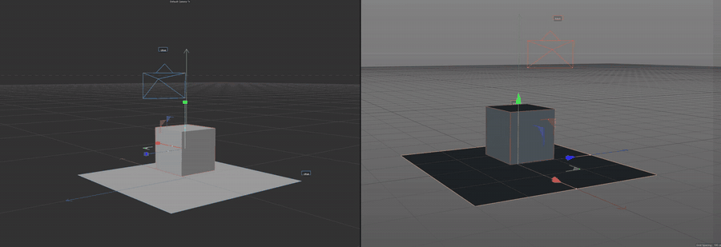

<p align="center">
  
</p>

<p align="center">
  <strong>Free, open-source live collaboration for Cinema 4D.</strong><br>
  Several people model and animate in the same scene at the same time, and everyone sees who is editing what.
</p>

<p align="center">
  <a href="https://github.com/MertDurmus41/collab-4d/actions/workflows/ci.yml"></a>
  <a href="LICENSE"></a>
  
  
</p>

<p align="center">
  <a href="#quick-start">Quick start</a> ·
  <a href="docs/internet.md">Work from different homes</a> ·
  <a href="ARCHITECTURE.md">Architecture</a> ·
  <a href="CONTRIBUTING.md">Contributing</a> ·
  <a href="docs/README.tr.md">Türkçe</a>
</p>

<p align="center">
  
</p>

> **Status:** early development. It works and has been tested live on Cinema 4D R19 and 2023, but it is not a stable release yet. Expect rough edges and keep backups of your scenes.

## Why Collab 4D?

- **One scene, several people.** Each person works in their own Cinema 4D and changes show up in everyone else's scene as they happen.
- **No stepping on each other.** Selecting an object locks it to you until you let go. Everyone sees who holds what in the *Being edited by others* list.
- **It shows who is where.** Every user gets a colour, and the *Users* list shows each person's Cinema 4D version and current frame.
- **Different versions can work together.** The demo above is Cinema 4D 2023 and R19 in one session.
- **Works over the internet.** Use [Tailscale](docs/internet.md) (free), or run the [standalone server](server/deploy/README.md) on a small cloud machine. No router settings needed.
- **Free and MIT licensed.** Community project, not made by Maxon.

## Features

- Host or join a session from a panel inside Cinema 4D, protected by a password
- Live sync of objects, modeling, animation and materials
- Rigs: XPresso graphs, Pose Morph, IK, skin and deformers
- Object locks and presence (who is in the scene, who is editing what)
- Standalone session server that needs no Cinema 4D (Docker file and one-command cloud setup included)
- Optional MCP page so an AI assistant can drive a live Cinema 4D (development aid, off by default)

See [ARCHITECTURE.md](ARCHITECTURE.md) for how it works. The notes there are in Turkish.

## Quick start

### 1. Install the plugin

1. Download `c4d_collab.zip` from the [latest release](https://github.com/MertDurmus41/collab-4d/releases/latest), or copy the `plugin/c4d_collab` folder from this repository.
2. In Cinema 4D choose **Edit → Preferences → Open Preferences Folder**, put the `c4d_collab` folder inside `plugins`, and restart Cinema 4D.
3. Open **Collab 4D** from the **Plugins** or **Extensions** menu.

### 2. Start a session

**Host** (the person whose scene everyone shares)

1. Type your name and a password of at least 4 characters.
2. Press **Host session**.
3. Send the address shown under *Others join with*, the port (`47800` by default) and the password to your team.

**Everyone else**

1. Type your name, then the host's address in **Host address**, the same **Port** and the same **Password**.
2. Press **Join**.

Working from different homes or countries? Install Tailscale and send the `100.x.x.x` address instead. The step-by-step guide is in [docs/internet.md](docs/internet.md).

To try it on one computer, run two Cinema 4D copies and use `127.0.0.1` as the host address.

### Run the standalone server

The server runs without Cinema 4D. Whoever joins first shares their open scene, and everyone after that joins it as a guest.

```bash
python server/run_server.py --port 47800 --password change-me
```

It also ships as a [Docker image](server/Dockerfile) and as a [one-command setup for a free cloud machine](server/deploy/README.md).

## Supported Cinema 4D versions

| Version | Status |
|---|---|
| R19, 2023 | Tested live in Cinema 4D |
| R17, R18, R20, R21, R22, R23, 2024, 2025, 2026 | API compatibility checked against the documentation and fallbacks tested with fake version profiles. **Not tried in a real copy yet.** |

The plugin targets Cinema 4D R17 and newer (R17–R22 run Python 2.7, R23 runs 3.7, 2023 runs 3.9, 2024 and later run 3.11+). Details and limits are in [ARCHITECTURE.md](ARCHITECTURE.md), section 7g. If you can open one of the untested versions, running the checks in [tests/c4d_manual/CHECKLIST.md](tests/c4d_manual/CHECKLIST.md) helps a lot.

## Documentation

| | |
|---|---|
| [docs/internet.md](docs/internet.md) | Work together from different homes with Tailscale or ZeroTier (Turkish and English) |
| [server/deploy/README.md](server/deploy/README.md) | Run the session server on a free cloud machine |
| [ARCHITECTURE.md](ARCHITECTURE.md) | Design, protocol, locks and measurements (Turkish) |
| [research/](research) | Background research notes (Turkish) |
| [CHANGELOG.md](CHANGELOG.md) | What changed in each version |

## Development

Tests need no Cinema 4D and run on Python 2.7 or 3.x:

```bash
python -m unittest discover -s tests/core -v
python -m unittest discover -s tests/adapter -v
python -m unittest discover -s tests/compat -v
```

Testing inside a real Cinema 4D is described in [tests/c4d_manual/CHECKLIST.md](tests/c4d_manual/CHECKLIST.md). More in [CONTRIBUTING.md](CONTRIBUTING.md).

## Roadmap

- [x] Live sessions with passwords, presence and object locks
- [x] Modeling, animation, materials and rig sync
- [x] Standalone server and cloud setup
- [x] Connection over Tailscale
- [ ] Test on the Cinema 4D versions listed as untested
- [ ] Windows installer
- [ ] First stable release

## Contributing

Bug reports, test results from other Cinema 4D versions and pull requests are welcome. Please read [CONTRIBUTING.md](CONTRIBUTING.md) first. Report security problems as described in [SECURITY.md](SECURITY.md).

## License

[MIT](LICENSE) © 2026 Collab 4D contributors. Collab 4D is a community project and is not affiliated with or endorsed by Maxon.